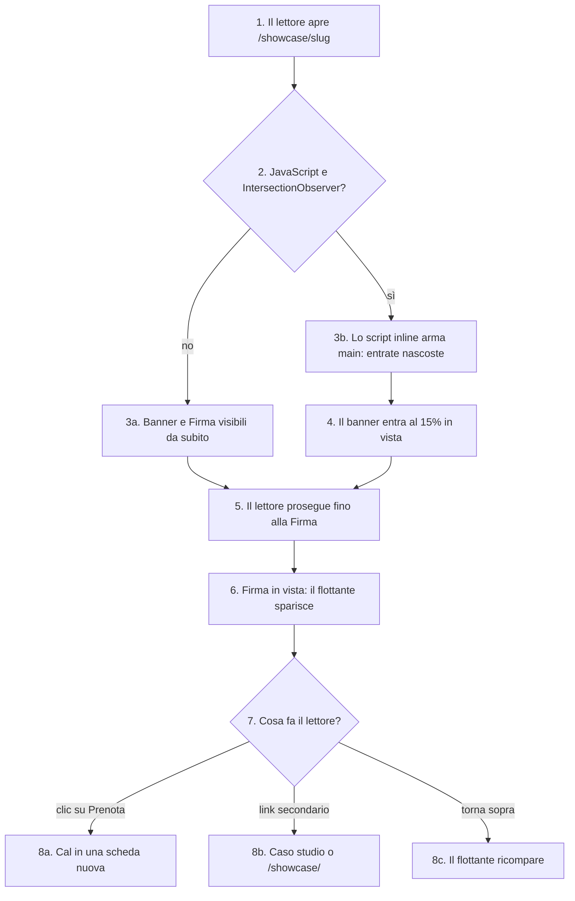

# Inviti alla call in una release

Chi arriva su una release (da ricerca, feed o LinkedIn) legge l'articolo e incontra due inviti alla call: un banner con un'offerta a metà del corpo e la Firma di Omar in fondo. Il pulsante flottante lascia il posto alla Firma.

1. Il lettore apre una pagina release, `/showcase/<slug>/`.
2. La pagina controlla se il browser ha JavaScript e `IntersectionObserver`.
3. Due percorsi:
   - **3a.** Senza, nessuno stato nascosto viene applicato: banner e Firma si vedono subito e i link funzionano (AC10).
   - **3b.** Con, lo script inline arma `<main>` (`data-armed`) prima che il corpo venga letto: niente lampo da visibile a nascosto, anche ricaricando su un'ancora.
4. Quando il 15% del banner intermedio entra nello schermo, il banner sale di 24 px e appare (`--ease-out-expo`, `--dur-reveal`), una volta sola. Con reduced motion fa solo la dissolvenza. Una release con meno di 2 titoli di sezione non ha il banner.
5. Il lettore arriva in fondo. La Firma entra solo in opacità (`--ease-out`, `--dur-swap`), uguale con reduced motion.
6. Con la Firma in vista il pulsante flottante «Prenota 30 minuti →» sparisce: due inviti uguali uno sopra l'altro non servono, e su telefono il flottante coprirebbe il bottone della Firma (AC12). Ricaricando in fondo il flottante non compare.
7. Il lettore sceglie.
8. Tre esiti:
   - **8a.** «Prenota →» del banner o «Prenota una call di 30 min» della Firma aprono Cal in una scheda nuova.
   - **8b.** Il link secondario della Firma porta al caso studio della release o, se non ce l'ha, ad «Altri articoli» (`/showcase/`).
   - **8c.** Tornando sopra la Firma il flottante ricompare.

## [Source: [[specs/showcase/cta-articoli/IMPLEMENTATION-NOTES]]]

- Verificato su 6 release × 7 larghezze (224–1440 px CSS) × 1× e 1,25×: nessuno scorrimento orizzontale né testo tagliato. Fino a 600 px il banner va a capo e il bottone rientra di 22 px.
- Non verificati: Mobile Safari, screen reader reali.

## [Source: [[specs/showcase/cta-articoli/REPORT]]]

- La review del 2026-11-18 ha trovato lo step 6 rotto con reduced motion: il flottante nascosto restava sopra il bottone della Firma, invisibile ma cliccabile. Corretto prima del push: nascosto vuol dire `visibility:hidden` e `pointer-events:none`, con il cambio di visibilità ritardato perché la dissolvenza si veda. Con reduced motion il flottante resta fermo e fa solo la dissolvenza (`--dur-swap` lineare, come `.reveal`).
