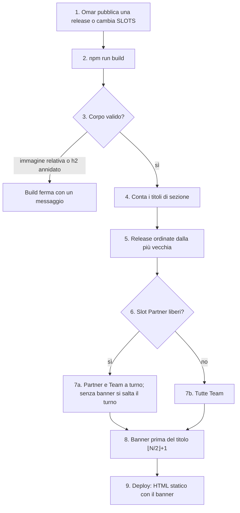

# Scelta del banner in build

Omar pubblica una release o cambia gli slot in `src/config.ts`; alla build successiva ogni release riceve il suo piano (Partner o Team) e il punto in cui sta il banner.

1. Omar aggiunge una release in `src/content/releases/` o cambia `SLOTS` in `src/config.ts`.
2. `npm run build`.
3. `[slug].astro` controlla il corpo HTML di ogni release e ferma la build se:
   - contiene il segnaposto di un'immagine relativa (`__ASTRO_IMAGE_="`), che non sopravvive all'iniezione con `set:html`;
   - contiene un `<h2` che non è un titolo di sezione, cioè dentro un contenitore (citazione, `
`, elenco, tabella…) o dentro un attributo (`titoliAnnidati` > 0).
4. `contaTitoli` conta i titoli di sezione: gli `<h2` a inizio riga e fuori da ogni contenitore. Con meno di 2 la release non ha banner.
5. `assegnaPiani` ordina le release dalla più vecchia.
6. Legge gli slot Partner liberi da `src/config.ts`.
7. Due casi:
   - **7a.** Con almeno uno slot libero, la più vecchia prende Partner, poi si alterna. Una release senza banner non consuma il turno. Oggi: P, T, P, T, P, T.
   - **7b.** Con gli slot finiti, tutte prendono Team.
8. `dividiAlCentro` taglia il corpo subito prima del titolo numero ⌊N/2⌋+1 (Jev, 7 titoli: prima di «Pulizia e sinonimi») e la pagina inserisce lì il banner. Il resto del corpo è identico byte per byte a `<Content />`.
9. Il deploy pubblica HTML statico: il banner cambia solo alla build successiva a un cambio di slot o di prezzi.

## [Source: [[specs/showcase/cta-articoli/IMPLEMENTATION-NOTES]]]

- L'espressione del corpo in `[slug].astro` (`{parti && piano ? <>…</> : <Content />}`) deve stare su una riga: spezzata, Astro aggiunge spazi attorno al banner.
- Provato con slot finiti (tutte Team), con una release temporanea a un titolo (nessun banner, turni invariati) e con un'immagine relativa (build ferma).

## [Source: [[specs/showcase/cta-articoli/REPORT]]]

- Lo step 3, secondo controllo, e la regola dello step 4 vengono dalla review del 2026-11-18: prima un `<h2` in un attributo o in una citazione veniva contato e il banner poteva finire dentro un tag senza errori.
- ⚠ Limite aperto (step 5): due release con la stessa data si ordinano per id, quindi una nuova release dello stesso giorno può spostare il turno di quelle dello stesso giorno. Vedi [[tech-debt/showcase/cta-articoli]].
