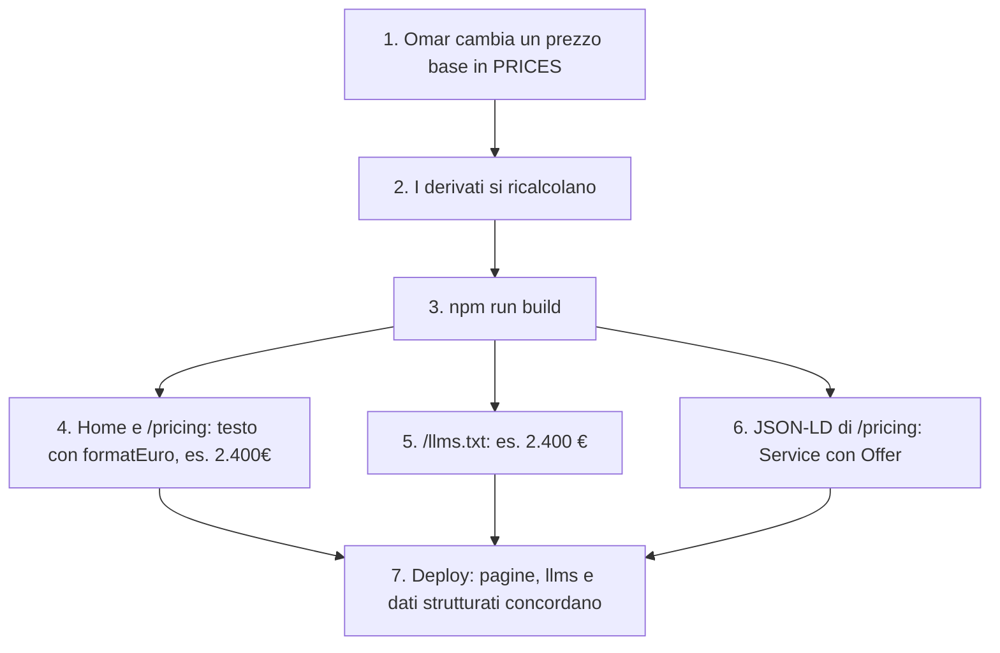

# Cambio di un prezzo

Omar cambia un prezzo base in `src/config.ts` e, alla build successiva, ogni posto del sito che mostra prezzi si aggiorna da solo.

1. Omar modifica uno dei prezzi base (Partner mensile, Partner trimestrale al mese, Team a sprint, Team a trimestre, MVP al mese) in `PRICES` di `src/config.ts`. Nessun altro file contiene importi scritti a mano (AC1).
2. I derivati si ricalcolano dai prezzi base, arrotondati all'euro: risparmio del Partner trimestrale, prezzo a sprint del trimestre Team, risparmio del trimestre Team, i "da …" della home (AC3).
3. `npm run build`, che è anche il gate del repo.
4. Home e `/pricing` scrivono gli importi con `formatEuro` e il simbolo attaccato ("2.400€").
5. `/llms.txt` li scrive con lo spazio ("2.400 €").
6. Il JSON-LD di `/pricing` dichiara i piani come `Service` con le loro `Offer` in EUR, IVA esclusa.
7. Dopo il deploy, sito, motori AI e dati strutturati mostrano gli stessi prezzi (AC4: Partner mensile a 2.500 ⇒ risparmio trimestrale 900€ ovunque).

## [Source: [[specs/sito/un-posto-solo/IMPLEMENTATION-NOTES]]]

- Lo step 6 è stato aggiunto dopo l'implementazione, su richiesta di Omar, togliendo il non-goal sui prezzi nei dati strutturati.
- Verificato con mutazioni su ogni prezzo base: le stringhe attese compaiono in home, pricing e `/llms.txt`; con i prezzi di oggi l'HTML è identico a quello di prima.
- Il "da" del Team in home resta lo sprint singolo (5.000€), non il prezzo a sprint del trimestre.
