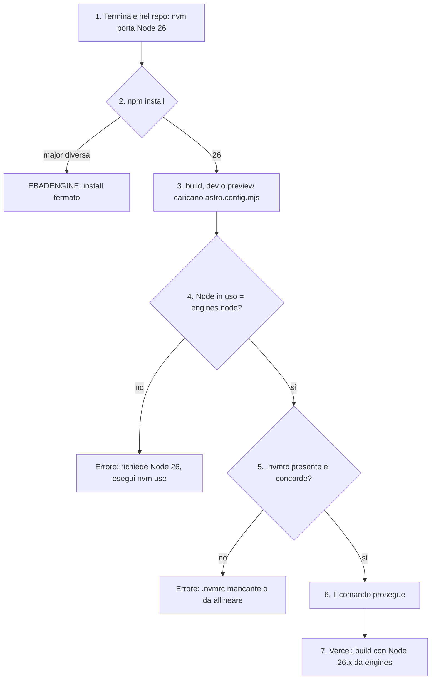

# Controllo della versione di Node

Ogni comando che installa o fa girare il sito si ferma se Node non è della major 26.

1. Un terminale nuovo sul Mac di Omar parte già su Node 26 (alias `default` di nvm, AC15); in un altro progetto basta `nvm use`.
2. `npm install` con `engine-strict=true` (`.npmrc`) si ferma con `EBADENGINE` e `Required: {"node":"26.x"}` su una major diversa (AC10).
3. `npm run build`, `dev` e `preview` caricano tutti `astro.config.mjs`.
4. La config confronta la major di `process.versions.node` con `engines.node` di `package.json`, unica fonte; se non coincidono la build si ferma col messaggio che chiede Node 26 (AC11, AC12).
5. Controlla poi che `.nvmrc` esista e chieda la stessa major.
6. Con Node 26 install e build finiscono senza errori né `EBADENGINE` (AC13).
7. Vercel legge `engines.node: "26.x"`. Omar ha confermato Node 26.x nel log di build (AC14, 2026-11-16).

## [Source: [[specs/sito/un-posto-solo/IMPLEMENTATION-NOTES]]]

- La shell dei tool degli agenti non carica nvm e resta sul Node di sistema (22.17.1): i comandi di verifica mettono `~/.nvm/versions/node/v26.13.1/bin` in testa al `PATH`.
- Con Node < 22.12 si vede prima l'errore di Astro sulla sua soglia minima, non quello del sito.
- `astro preview` lanciato da una shell d'agente scrive il messaggio solo in `.astro/preview.log`.
