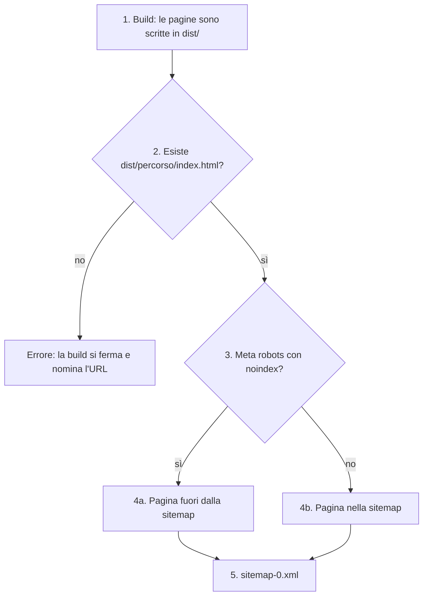

# Esclusione dalla sitemap

A fine build, `@astrojs/sitemap` chiede per ogni pagina se entra nella sitemap. Decide il robots `noindex` dell'HTML già scritto, nient'altro.

1. `npm run build` scrive ogni pagina in `dist/<percorso>/index.html`; poi `@astrojs/sitemap` chiama il filtro di `astro.config.mjs` per ogni URL.
2. Il filtro cerca l'HTML della pagina. Se non c'è (per esempio con `build.format: 'file'`), lancia un errore e la build esce con 1, invece di produrre in silenzio una sitemap sbagliata.
3. Legge i tag `<meta>` e controlla se ce n'è uno `name="robots"` con `noindex` nel `content`.
4. a. Con `noindex` la pagina resta fuori: `/benvenuto`, ogni prototipo pubblicato in `/p/*`, qualunque nuova pagina privata (AC6, AC8, AC9). b. Senza, entra (AC8).
5. Con le pagine di oggi la sitemap ha 7 URL: home, `/pricing/`, `/termini/` e i 4 casi studio (AC7).

## [Source: [[specs/sito/un-posto-solo/IMPLEMENTATION-NOTES]]]

- Prima l'esclusione era una regex scritta a mano; verificato che una nuova sotto-pagina `noindex` di `/benvenuto` ci finiva dentro, e ora no.
- Il filtro di `@astrojs/sitemap@3.7.5` è sincrono e vuole un booleano stretto: un valore diverso fa sparire la sitemap senza errori, un'eccezione ferma la build.
